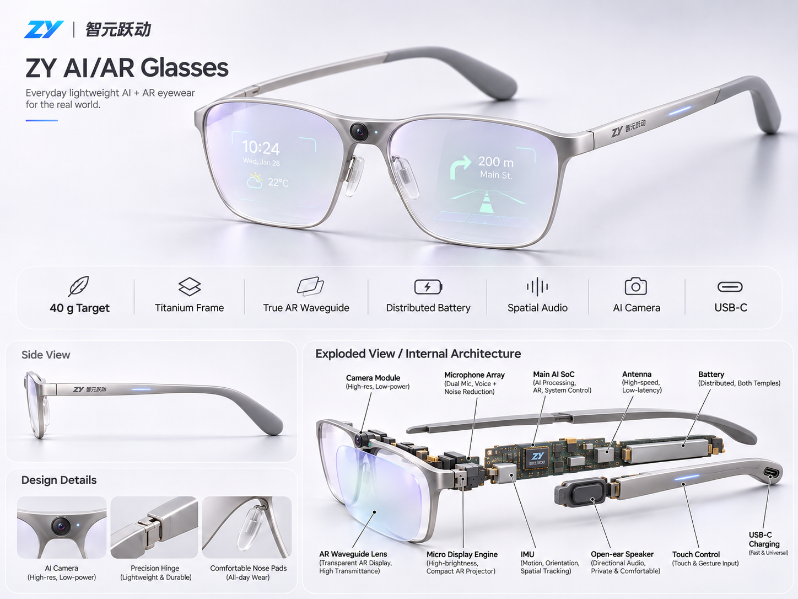

# ZY AI/AR Glasses — EVT-1 外观驱动设计基线

2026-11-12；由用户 V1.0/ID-HW-A01 派生的工程化输入 ID-HW-A02。**外观方向已确认，真实装配、器件选型与制造尚未放行。**

本图为用户本轮明确提供的银色 ZY 母版，替代旧通用 `60207a55-074f-4e33-84d5-29b86ccc7062.png` 的外观参考地位；旧图和既有工程未删除。原始 [V1.0输入](references/ZY_AIAR_Glasses_外观驱动硬件架构_V1.0.md) 与母版原字节、SHA-256见 `references/provenance.json`。源文件中的任务书和宣传文字不代表已执行、实测、采购或发布。

冻结视觉特征：银色全框、鼻梁中置相机及外向硬件隐私灯、双目透明AR波导、纤薄镜腿/精密铰链、左右分布式电池、开放式音频、侧触控/状态灯、右尾USB-C。40 g为挑战、50 g为首轮工程设计目标、55 g为警戒；处方配镜版另称。图中钛材、空间音频、续航等未被证明。

| 工程输入 | 产物与边界 |
|---|---|
| 分体架构与22项需求 | [HW_ARCHITECTURE.md](HW_ARCHITECTURE.md)：左主控无线、右独立通话音频/IMU、两眼完整光路、鼻梁相机与独立联锁；S3仅为候选与EVT-0验证平台 |
| 板级/FPC接口 | [INTERFACES.csv](INTERFACES.csv)：23项接口，电压、针序、连接器、动态弯折与反灌等均显式阻断，未沿用R3 J3/J4作为量产接口 |
| 双侧电源与安全 | [POWER_AND_SAFETY_GATES.md](POWER_AND_SAFETY_GATES.md)、[POWER_BUDGET.csv](POWER_BUDGET.csv)：每包独立保护/温度/限流与隔离；统一充电路径未选；Wh/瓦数/容量/续航不虚填 |
| 光学候选筛选 | [OPTICS_SELECTION.md](OPTICS_SELECTION.md)：区分微显示、投射光机、波导和成套双目模组；公开参数不作整机实测 |
| 质量分配 | [MASS_BUDGET.json](MASS_BUDGET.json)：六类目标12+14+7+9+6+2=50 g，实际质量全未知；保留14 g光学分配与公开候选约16 g波导字段的冲突 |
| 真实装配入口 | [CAD_GATE.md](CAD_GATE.md)、[ASSEMBLY_INPUTS.json](ASSEMBLY_INPUTS.json)：15个真实几何输入槽位、8项CAD/物理门槛；不以示意模型冒充装配验证 |
| EVT-0并行推进 | [EVT0_R4_CARRY_FORWARD.md](EVT0_R4_CARRY_FORWARD.md)与 [R4独立工程](../evt0-r4-review/README.md)：只补CHG_EN1；未连59→58，DRC仍失败；R3全部74文件SHA保持一致 |

所有F01–F22保留16 P0、5 P1、1预研。两块独立受保护电芯不等于已形成安全双电池系统；未确认的电芯/光机/FPC/针序继续阻断。所有现有固件profile保持 `privacy_interlock_verified=false`，本轮没有新驱动、采集解锁、真实蓝牙通话、三维适配或整机样件结果。

运行 `python hardware/evt1-id/verify_design_inputs.py` 只核对来源哈希、目标分配、需求/接口与未知值状态、R3保护及R4报告一致性。它不证明硬件安全，不替代ERC/DRC、供应商受控图纸和实机测量；验证证据位于 `evidence/design-input-check.json`。
